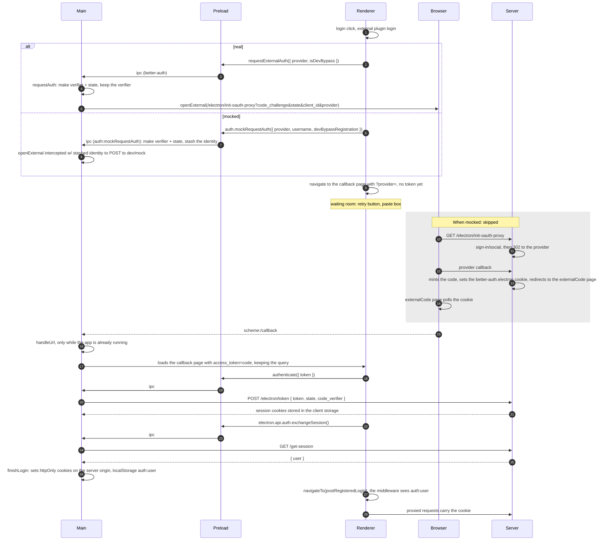

# @witchcraft/nuxt-auth

[![Release][release-src]][release-href]
[![npm version][npm-version-src]][npm-version-href]
[![npm downloads][npm-downloads-src]][npm-downloads-href]
[![License][license-src]][license-href]
[![Nuxt][nuxt-src]][nuxt-href]

Nuxt auth module built on [better-auth](https://www.better-auth.com). Tries to set up nearly everything + some extra goodies.


## Playground

There is a playground that runs with in-memory postgres, but it must be run locally as it requires env secrets to be set.
## Install

The module requires the `@witchcraft/ui` module for ui components but those are optional so it's not needed if you won't be using them.

```bash
pnpx nuxi module add @witchcraft/ui
```

`@witchcraft/nuxt-logger` is also recommended for it's polymorphic-ish loggers (see playground's usage of `use*Logger`s). All logs are objects with at least an `ns` (namespace) property.

```bash
pnpx nuxi module add @witchcraft/nuxt-logger

```

## Usage

### Secrets

The following env variables are needed:

- `NUXT_AUTH_SECRET` // for nuxt-auth
- `NUXT_AUTH_{PROVIDER}_CLIENT_ID`
- `NUXT_AUTH_{PROVIDER}_CLIENT_SECRET`

`NUXT_AUTH_SECRET` must be at least 32 bytes (better-auth's minimum). In production the module throws on boot when it is missing or shorter. Generate one with `openssl rand -base64 32`.

Set the ones you need in the nuxt config. There is a helper function for doing this:

```ts
import { genAuthSecretKeys } from "@witchcraft/nuxt-auth/build/genAuthSecretKeys"
// nuxt.config.ts
export default defineNuxtConfig({
	runtimeConfig: {
		...genAuthSecretKeys(["google", "github"]),
		// or manually
		authGoogleClientSecret: "",
		authGoogleClientId: "",
		public: {
			// this is set automatically (for production, it's always true, for dev it's true if nuxt.options.devServer.https is defined)
			// this determines whether to use https in the auth callback url
			// isSecure: ...
		},
		enabledProviders: ["google", "github"],
		// optional, electron apps only
		// deeplinkSchemes: { electron: "myapp" },
	}
})
```

`createBetterAuth` trusts `appUrl`. Add extra origins through `betterAuthOptions.trustedOrigins` (list is merged with the defaults):

The callback url is `{http/https}://localhost:3000/api/auth/callback/{PROVIDER}`.
Note that if using `https`, both the trusted origin and the callback url must have https in the provider's config.

### Basic Setup

#### DB


The module provides `authUserFields` (the columns it needs on the user's table, including `username`) plus `createAuthSchema` for the session, account, and verification tables. Spread the fields into your own users table. Table shapes follow the [better-auth core schema](https://www.better-auth.com/docs/concepts/database).
```ts
// path/to/schema.ts
// careful not to use nuxt paths, or drizzle won't be able to import them when when generating migrations, etc
import { authUserFields, createAuthSchema } from "@witchcraft/nuxt-auth/server/utils/createAuthSchema"
export const users = pgTable("users", {
	id: uuid("id").primaryKey().unique()
		.notNull()
	// ... rest of your table
	...authUserFields
})

export const {
	authAccounts,
	authSessions,
	authVerifications,
	authProvidersRelations,
	authSessionRelations
} = createAuthSchema(users)
```

#### SessionManager and Routes


First create your auth instance with your db in some file (it can be anywhere) and export it.

Then create two files:
```
- server
	// the better auth instance
	auth.ts
	- middleware
		- auth.ts
	- api
		- auth
			// this is named like this **literally**, it is a catch-all route
			- [...].ts
```

This creates the auth instance.
```ts [server/auth.ts]
import { createBetterAuth } from "@witchcraft/nuxt-auth/server/utils/createBetterAuth"

export const auth = createBetterAuth({
	db,
	schema: { users, authAccounts, authSessions, authVerifications },
	// you can gate here or at the nuxt config level, up to you, if you are using electron I suggest at the config level to start (see the playground)
	appUrl: import.meta.dev
		? `${useRuntimeConfig().public.auth.isSecure ? "https" : "http"}://localhost:${useRuntimeConfig().port}`
		: useRuntimeConfig().public.siteUrl as string,
	usernameSchema: z.string().min(3).max(32),
	devBypassAuth: true, // allow the dev only dev-mock bypass
	logger: useServerLogger()
})
```

This creates the catch-all api handler.
```ts [server/api/auth/[...].ts]
import { auth } from "../auth.js"

export default defineEventHandler(event => {
	return auth.handler(toWebRequest(event))
})
```

The following creates the middleware that sets the user/session on the request context.

**IMPORTANT: better-auth validates origins and handles CSRF for its own endpoints. It does not protect your application's own routes. Use nuxt-security or equivalent for those.**

```ts
// server/middleware/auth.ts
import { auth } from "../auth.js"

export default createAuthMiddleware(auth, useServerLogger())
```

The middleware fills `event.context.user` plus `event.context.session` (null when logged out). To guard a route, use the `assertEventWithAuthorizedUser` server util. It throws a 401 on a missing user and narrows the event type past the check.

### Create the Pages

See the playground for a full example, but you will need to create the following pages, components are provided to help create these:

- `/login`
- `/register`
- `/code` (optional, only if using external auth handlers)

### Customizing Login Handling

By default the module will redirect to corresponding api route when calling `useAuth().login/logout()`.

In some cases you may want to customize this behavior, such as when calling this from a desktop app where you need to open a browser instance.

For handling auth in external apps, see [External Auth Handlers](#external-auth-handlers).

### Changing Routes

While not recommended, you can change the routes used by the module by setting the `authApiRouteBase` (changing where the server API is) and `authRoutes` options (changing where redirects happen to).

#### Middleware

### Auth Middleware

A global middleware is registered to determine the user's logged in state (through the better-auth client session), on every navigation. It does not redirect by default.

Reading it is only done on page load or before (because they might redirect) any actions (login/logout/register\*) so that we don't fetch from the server on every page navigation.

You can use `useAuth().setFetchUserOnNavigation(...)` to allow fetch on the next navigation. The middleware then disables fetching again to prevent further fetching.

The useState keys used to make this work are `auth:_fetch` and `auth:user` if you want to inspect them in the dev tools.

You can also fetch from the api manually if you want and set `auth:user` yourself or do it some other way.

\* The AuthUserRegistration component automatically does this, if you don't use it, you'll need to do it after a succesful registration, but before navigating away. 

### Route Protection

The module does not redirect by default. You have to add `authProtected` to the page's middleware:

```ts
definePageMeta({ middleware: "authProtected" })
```

This will automatically redirect a signed out visitor to the `unauthenticated` route (home by default) and an unregistered user to the register page, unless the page sets a `redirectTo`.

Additionally you can set the following meta properties to control the middleware:

```ts
definePageMeta({
	middleware: "authProtected",
	auth: {
		// only allow users on the page that match the given condition.
	 	only: "authenticated" /* | "registered" | "authenticated-unregistered" | "unauthenticated" */

		// change the redirect path
		// or can use the special values "$login", "$register", "$postRegisteredLogin", "$externalCode"
		redirectTo: "/some/path", 
	}
})
```
You can register additional paths with the `additionalMiddlewarePaths` option. `only` can also be a function that receives the refs like `isAuthenticated` (e.g. `only: ({isAuthenticated}) => !isAuthenticated.value`.

A page that only makes sense for a signed in user can still be rendered on the server, but a local user exists only in that window's storage, so the server cannot see them, and `authProtected` would redirect the render instead of painting the page. Set `disableServerRedirect: true` on the page to render it anyway and let the browser decide the redirect or set `ssr: false` for the route.

### Clearing User Data on Logout 

You can add a `beforeLogout` listener to clear the user data on logout by using `useAuth().on/off`. All added listeners are awaited before actually logging out.

```ts
useAuth().on("beforeLogout", clearUserData)
```

### Branding

The module does not create any pages by default.

Only components like `AuthLoginProviderButtons` are provided. It's button styles and logos can be customized/extended by setting the `providerStyles` prop on the component.

### Other Exports

#### Components

`AuthSessionStatus` - Provided for creating a login button / status indificator in the nav bar.
`AuthLoginProviderButtons` - Provided for creating login the buttons.
`AuthUserRegistration` - Provided for creating a simple registration form with a username input and check. 
	- It checks against the built-in better-auth endpoint `${authApiRouteBase}/username/valid` (mounted under the app's auth base path).
	- And it submits through the better-auth client (`updateUser` with `body: { username }`).
	- It has a slot for easily adding more fields.
`AuthExternalCode` - Provided for creating a code page for external auth handlers, see [External Auth Handlers](#external-auth-handlers).
`AuthMocker` - Provided for building the app's mock auth page at the `mockAuth` route (`/auth/mock` by default, the module strips it from non-dev builds), see [Mocking Auth](#mocking-auth-experimental).
`AuthMockBypassRegistrationFields` - Provided to easily setup mocking at other points (such as the login for external apps which completely bypass the browser).

#### Composables

`useAuth` - For getting user info, status, login in and out, and getting routes.

#### Types

`defaultZodUsernameSchema` - A zod schema for validating usernames. The module uses it as the default when no `usernameSchema` is passed, it's also nice to have on hand for writing a custom username validation route. We wire the min/max length internally to better-auth's options and it serves as validation on top of theirs and for local users which don't go through the server at all.

### Common Account Data Access


The user's provider avatar is available as `user.image` (set from the provider profile on login).

Registration state is tracked with `isRegistered` (a better-auth `additionalFields` entry defaulting to false). It flips to true automatically through a `databaseHooks` entry when a username is set.

### Extending the Router

You can extend the router at `/api/auth` with `betterAuthOptions` plugin endpoints (arrays concatenate with the module plugins, see the [better-auth plugin docs](https://www.better-auth.com/docs/concepts/plugins) for the `endpoints` shape):

```ts
createBetterAuth({
	// ... the rest of your options
	betterAuthOptions: {
		plugins: [myPluginWithEndpoints()]
	}
})
```

### Local-only users

Unlike better-auth's "anonymouse" plugin. Local-only users have no server account at all. The `local-only-users` client plugin creates them in the shape of real users, entirely in `localStorage`. `useAuth` then wraps better-auth's client to intercept certain calls and wrote them to the plugin's methods instead only when the provider/user is "local". The rest of the methods that would not apply are rejected. See [authClientWrapper.ts](src/runtime/utils/authClientWrapper.ts) for the full table.

Note that a user can also be `local` on an app, it's just the storage backend part usually changes, so their type is still `local`. External apps that support local users should implement an external plugin, if like `@witchcraft/nuxt-electron` they use a session per user. The playground example and the included electron utilities show how to store and manage via electron. If the app does everything with a single session (not reccommended) you can leave local user storage to the single session.

There is no upgrade path at the moment to a normal user (there will be in the future): logging in normally just creates a real session, merging any local data into it is up to the app.

##### How

The default `authGlobal` middleware reads `localStorage` first for the `auth:user` key and uses that user if it carries a `type`. It skips the server. Otherwise it checks the session and falls back to the stored user.

So if we write to that key with a user's shape and type `local`, it will just use it.

A user's `type` may be one of the following:
1. `type`: undefined: web users. The auth is checked again on each page load. A dead session means no user and the protected routes send them to sign-in.
2. `type: "external"`: electron/desktop user. The stored user stays across relaunches and the window never waits on the server for it.
3. `type: "local"`: completely local users. Similar to external users, except they have no server session so server methods just error for them. 

This is safe because **you should always check authentication on the server side, if you're not that's inherently unsafe**.

### External Auth Handlers

An external auth handler refers to auth flows handled externally in part, such as by a desktop app. These require a more complicated auth flow. Only electron is fully shown and supported with helpers.

#### Electron

The full example setup can be found in the playground. This is the sign-in flow.




Note that unlike better-auth's default implementation, `@witchcraft/nuxt-electron`'s proxy allows us the real cookie on the session, stored against the origin of `publicServerUrl` (your auth server), and it will be sent with proxied requests.

We cannot store it on `app://bundle` for two reasons. Chromium refuses secure cookies for every non-http(s) scheme, so a window served over `app://bundle` or `file://` can never hold one, no matter what privileges the scheme has. Second, server requests get proxied to the real server anyways as is intended with `@witchcraft/nuxt-electron`.

- **Avoid passing nuxt's `useFetch` to better-auth. The better auth client is purposely built on `publicServerUrl` and rewrites every request back to a relative path, so it resolves against the window origin and goes through that proxy. A method that takes its own fetch, such as `auth.client.useSession(useFetch)`, replaces that rewrite and requests the absolute url instead, where no proxy adds the session cookie.

- `@witchcraft/nuxt-electon`'s `additionalRoutes` option decides which pages exist in the electron bundle. nuxt-electron drops every page except `/`, the electron route and the ones listed, so the callback page and the login page have to be there, because main loads them from the bundled static pages.

- Electron needs to be setup to take a the single instance lock so it can handle the token on the incoming scheme links. It should handle `second-instance` and `open-url`. A url that arrives while the app is closed is ignored, because the verifier only lives in the running process's memory.

- For mocking auth, since you could test a production version of an electron app against a dev server, mocking on the electron side is only enabled with env `TEST`. Without `TEST`, the mock is still reachable through the browser.

- The login handler is platform agnostic. The platform supplies `requestExternalAuth`, which starts its own login, and gets `isDevBypass` and context about the type of mocking wanted so it can pick the mock instead of the real sign-in.

#### Post-Expiration Session Persistance

In desktop apps we usually want the login session to persist for as long as possible. The module offers an alternative to making the session longer, it just pretends the user is logged in, similarly to local users but with type `external`. See above for details.

The user is considered authenticated on the client side even if they don't have the right cookies to send with requests because they've expired.

This is safe because **you should always check authentication on the server side, if you're not that's inherently unsafe**.

##### Differentiating Between Expired External Users and Not.

The expiry is stored in local storage at the key `externalExpiryStorageKey` (`auth:external:expiresAt` in ms). `logout` removes it. Only external users store this as they are the only ones that can expire and still navigate. The external app should set this when it get's the session.

The included electron utils write it at login from the session it exchanges, and again whenever the server sets or replaces the window's session cookie. The middleware writes it on load, for an external user, from the session it reads. 

You can use `useAuth().isExpired()` to estimate it on the spot against the clock.
The middleware also writes `useState("auth:isExpired")` on every client navigation based on the time and stored value to avoid re-calculating it with a timer since it's not something you need to be recalculating all the time. 

You can use `useAuth().isExpired()` to estimate it on the spot against the clock.
The middleware uses it to also write `useState("auth:isExpired")` on every client navigation based on the time and stored value to avoid re-calculating it with a timer since it's not something you need to be recalculating all the time. 

And it is not meant to be foolproof anyways. It's meant only to give UI indications for when, for example, you might re-prompt for credentials directly instead of even allowing an action to happen. It is completely possible for it to be wrong!

## Mocking Auth (experimental)

The auth middleware can mock authentication for testing purposes. This is only allowed if `devBypassAuth` is set to true when creating the auth instance (it defaults to false, and the plugin itself only runs in dev). The client sends a `devBypass` query param with their login.

To use the mocked auth, in your login component you can add a checkbox to enable/disable the bypass option which you can pass to the the `AuthLoginProviderButtons` component:

```vue
<template>
	<AuthLoginProviderButtons @login="login($event, { devBypass })" />
</template>

<script lang="ts">
const { login } = useAuth(...)
</script>
```

If true, the login request will add the `devBypass` query param so that the server will redirect to the `mockAuth` route (`/auth/mock` with the provider as a query param) instead of the provider's url.

You should place the `AuthMocker` in this route (**the module will remove the route for non-dev builds**). It will allow you to specify a username to login as. When you press the `AuthMocker`'s submit it will redirect to the server's callback with the username and the bypass request in the query params.

The dev-mock plugin hooks `callback/${provider}` paths with `?devBypass=true` plus an optional `username` or `id` queries.

Without `devBypassRegistration` the request must not carry a username and the user is named after their id. 

With it the username comes from the query, falling back to the `generateUser`, option, then to `username_<id>`, **trimmed to fit the default username schema (CAREFUL)**. `POST /dev/mock` takes the same fields (`username`, `id`, `provider`, `devBypassRegistration`) as a body.


If the user does not exist, it will be created using this information. 


```ts
createBetterAuth({
	// ... the rest of your options
	generateUser: () => {
		const id = crypto.randomUUID()
		return {
			
			// override the fallback user, e.g. change the email created
			id,
			email: generateEmail(id)
		}
	},
})
```

The server will then bypass auth and create a session for the user.

We do not use better-auth's mocking utils because they skip the sign-in flow, they just give you a signed-in user, you cannot test any flows.

## Testing the Server APIs directly with Mock Users

This is a bit more complicated because the ecosystem is not very mature here. The nuxt test utils (really unjs/ofetch) do not expose a $fetch that can use cookies so we have to create it with the help of [`fetch-cookies`](https://www.npmjs.com/package/fetch-cookie). ofetch is stateless by design and will not persist cookies between requests ([unjs/ofetch#382](https://github.com/unjs/ofetch/issues/382), [unjs/ofetch#435](https://github.com/unjs/ofetch/issues/435)):

Create a utility function somewhere:

```ts [tests/utils/fetch.ts]
import makeFetchCookie from "fetch-cookie"
import type { FetchOptions } from "ofetch"
import { $fetch as $ofetch } from "ofetch"
import { useTestContext } from "@nuxt/test-utils/e2e"
import { joinURL } from "ufo"
import {
	parse,
	serialize
} from "cookie-es"


// copied from nuxt/test-utils
function getUrl(path: string) {
	const ctx = useTestContext()
	if (!ctx.url) {
		throw new Error("url is not available (is server option enabled?)")
	}
	if (path.startsWith(ctx.url)) {
		return path
	}
	return joinURL(ctx.url, path)
}

const fetchWithCookies = makeFetchCookie($ofetch.native)
const oFetchWithCookies = $ofetch.create({ }, { fetch: fetchWithCookies })
export function $fetch(url: string, options?: Omit<FetchOptions, "url">) {
	return oFetchWithCookies(getUrl(url), options)
}
export const cookieJar = fetchWithCookies.cookieJar

export function get$fetchCookies() {
	return fetchWithCookies.cookieJar.getCookieString(getUrl(""))
}
export function set$fetchCookies(cookies: string) {
	return fetchWithCookies.cookieJar.setCookie(cookies, getUrl(""), { ignoreError: false })
}
export async function clear$fetchCookies() {
	await set$fetchCookies(serialize("test", "test"))
	const setCookies = await cookieJar.getCookieString(getUrl(""))
	const parsedCookies = parse(setCookies)
	await Promise.all(Object.keys(parsedCookies).map(async (cookie) => {
		await fetchWithCookies.cookieJar.setCookie(serialize(cookie, "", { maxAge: 0 }), getUrl(""), { ignoreError: false })
	}))
}
export function use$fetchOriginHeader() {
	return {
		Origin: getUrl("/")
	}
}
```

Use in tests like this:
```ts [tests/sometest.e2e.test.ts]
import {
	$fetch,
	get$fetchCookies,
	clear$fetchCookies
} from "~~/tests/utils/fetch.js"

describe("server/db/users", async () => {
	beforeAll(async () => {
		await setup({
			...
			// I prefer to run a local instance separate from vitest
			// otherwise nuxt is built with every test which is very slow
			// see https://github.com/nuxt/test-utils/issues/314
			// host: "https://localhost:3000",
			// port: 3000
		})
	})
	beforeEach(async () => {
		await clear$fetchCookies()
	})
	test("bypassed login", async () => {
		await $fetch("/api/auth/callback/google", {
			method: "GET",
			query: {
				username: "test",
				devBypass: true,
				devBypassRegistration: true,
			},
			credentials: "include",
		})
		console.log(await get$fetchCookies())
		const userInfo = await $fetch("/api/auth/get-session", {
			method: "GET",
			credentials: "include",	
		})
		expect(userInfo.user.username).toBe("test")
		expect(userInfo.user.isRegistered).toBe(true)
		console.log({userInfo})
	})
	test("cookies cleared", async () => {
		expect(await get$fetchCookies()).toBe("")
	})
})
```

Note that you will need to add the origin header to non-GET requests since nuxt-security guards in part against CRSF by checking the origin header:
```ts 
test("put works", async () => {
	await $fetch(`/api/some/api`, {
		method: "PUT",
		credentials: "include",
		headers: use$fetchOriginHeader()
	})
})
```


<!-- Badges -->
[release-src]: https://github.com/witchcraftjs/nuxt-auth/actions/workflows/release.yml/badge.svg
[release-href]: https://github.com/witchcraftjs/nuxt-auth/actions/workflows/release.yml

[npm-version-src]: https://img.shields.io/npm/v/@witchcraft/nuxt-auth/latest.svg?style=flat&colorA=020420&colorB=00DC82
[npm-version-href]: https://npmjs.com/package/@witchcraft/nuxt-auth

[npm-downloads-src]: https://img.shields.io/npm/dm/@witchcraft/nuxt-auth.svg?style=flat&colorA=020420&colorB=00DC82
[npm-downloads-href]: https://npmjs.com/package/@witchcraft/nuxt-auth

[license-src]: https://img.shields.io/npm/l/@witchcraft/nuxt-auth.svg?style=flat&colorA=020420&colorB=00DC82
[license-href]: https://npmjs.com/package/@witchcraft/nuxt-auth

[nuxt-src]: https://img.shields.io/badge/Nuxt-020420?logo=nuxt.js
[nuxt-href]: https://nuxt.com
